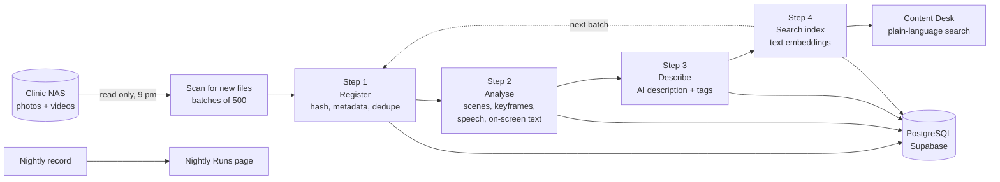

# Klinik Dr Inder Media Library Pipeline

An automated pipeline that turns a hair-transplant clinic's raw archive of photos and videos into a
searchable media library. Every night it finds new files on the clinic's NAS, analyses them (scenes,
speech, on-screen text), has an AI model describe what is in each file and scene, and makes them
searchable in plain language on a staff search page.

> This repository is a cleaned portfolio copy of a private production system. Patient data, clinic
> infrastructure details (addresses, database ids, folder names) and run reports are removed.
> Placeholders such as `YOUR_PROJECT_REF` mark where real values go.

**Built by:** Nusaiba Rahman Adrita · 2026

## Results

| | |
|---|---|
| Files catalogued | about 108,701 photos and videos (about 98,865 photos, 9,836 videos) |
| Video scenes | over 109,000 scenes, each with its own description and search entry |
| New uploads | analysed overnight and searchable the next morning, with no one starting any step |
| Video speed-up | about 5 minutes per video down to about 20 seconds, by making a whole-library safety check incremental |
| Privacy | patient names live in separate private tables; logs hold counts and item codes only |

## How it works

1. **Scan** (`pipeline/run_ml_test.py plan`): lists every media file on the NAS share that the library
   does not have yet, skips files changed in the last hour (still copying), and writes batches of 500.
   
2. **Step 1, Register** (`step1_ingest.py`, `writer.py`): copies each file to a local cache, hashes it
   (SHA-256, plus MD5 for later cloud matching), reads capture date, size, duration and orientation,
   and stores one asset per unique file. Exact duplicates are linked, not stored twice.
   
3. **Step 2, Analyse** (`step2_analyse.py`, `step2_worker.py`, `step2_stills*.py`):
   - videos: scene detection, keyframes, speech-to-text with Whisper large-v3-turbo on Apple silicon
     (MLX), on-screen text with OCR tuned by a clinic word list, raw/edited classification;
   - photos: on-screen text with Apple Vision OCR.
   -Each video runs in a separate worker process with time ceilings per stage, so one bad file cannot
   stall a batch.

4. **Step 3, Describe** (`step3_v3_supervise.py`, `edge_functions/media-analyse.ts`): a Supabase Edge
   Function sends keyframes, transcript and OCR to an AI model (DeepSeek), which returns a structured
   description: people (look, age range, role, expression), activity, treatment, setting, mood. Spend
   caps and a balance guard stop it before money runs out.
   
6. **Step 4, Search index** (`step4_v3_embed.py`, `edge_functions/embed.ts`): every description becomes a
   text embedding (gte-small, run inside Supabase), so search works by meaning, not exact words.
   
8. **Content Desk** (`web/content_desk.html`, `database/016-017`): staff describe what they need in a
   sentence ("Dr Inder marking the hairline of a man in his 30s"). An AI model turns the request into a
   structured brief, a ranked SQL search (`desk_search`) scores scenes on people, activities, phrases
   and full-text match, and the model picks the best files. "Show different files" excludes everything
   already shown.
   
10. **Nightly automation** (`pipeline/nightly.py`, `ops/`): a macOS launchd job runs the whole chain at
   9 pm. Each batch goes through Steps 1-4 and becomes searchable on its own. Every run writes a row
   to `nightly_runs`, shown on `web/nightly_runs.html`, so a missed or failed night is visible.

## Engineering choices

- **Resume anywhere.** Every step works out what is left from the database, so a run stopped by a
  power cut, an unplugged drive or a spend cap continues with the same command and never does work
  twice.
- **One transaction per file, guarded.** Before each write, a pre-flight check confirms the
  connection points at the intended project and that no rows have gone missing
  (`preflight.py`). On a 100k-file library the full check took 60-80 s and ran about five times per
  video; it now runs a cheap row-count check per write and the full check every 100 writes.
- **Wrong-database protection.** `db.py` refuses any connection string that does not name the
  intended project, and never prints a secret.
- **Read-only source.** The NAS is never written to, and files from the patient-records folder are
  kept in their own group, apart from marketing material.
- **Privacy by design.** File names often contain patient names, so batch lists and per-file logs
  stay on the local drive, nightly logs hold counts only, and names that may be shown (staff,
  doctors) are kept apart from private names.

## Repository layout

| Folder | What is in it |
|---|---|
| `pipeline/` | Python: the controller, the nightly run, Steps 1-4, the safety checks, the local file viewer |
| `edge_functions/` | Supabase Edge Functions (TypeScript, Deno): AI description and embeddings |
| `database/` | Core table layout and the SQL for the AI analyser, search and the nightly record |
| `web/` | The Content Desk search page and the Nightly Runs page (Claude artifacts) |
| `ops/` | The macOS launchd jobs for the 9 pm run and the file viewer |

## Tech

Python 3.12 · PostgreSQL (Supabase) · Supabase Edge Functions (Deno/TypeScript) · FFmpeg · MLX Whisper ·
Apple Vision OCR · RapidOCR · DeepSeek · gte-small embeddings · macOS launchd · Tailscale

## Running it

This copy is for reading; it expects the clinic's database and NAS. To adapt it:

1. Create a Supabase project and apply `database/000_core_tables.sql`, then the other SQL files in order.
2. Copy `.env.example` to `.env` and fill in the values (never commit `.env`).
3. `python -m venv venv && venv/bin/pip install -r requirements.txt` (macOS on Apple silicon for the
   MLX and Apple Vision parts).
4. `venv/bin/python pipeline/run_ml_test.py plan --all --batch-size 500`, then
   `venv/bin/python pipeline/run_ml_test.py run --manifest <batch file> --to-step step4`.
